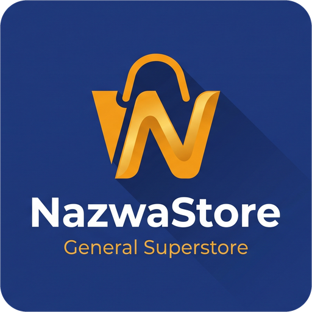
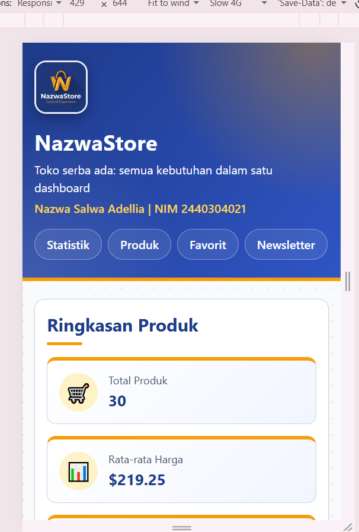
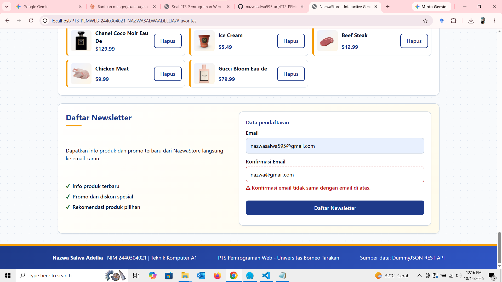

<p align="center">
  
</p>

# NazwaStore - Interactive General Superstore Dashboard

> **Mini Project Front-End Individual** - Penilaian Tengah Semester (PTS) Pemrograman Web
> Program Studi Teknik Komputer, Universitas Borneo Tarakan

---

## 1. Identitas Mahasiswa

| Informasi | Keterangan |
| --- | --- |
| **Nama Lengkap** | Nazwa Salwa Adellia |
| **NIM** | 2440304021 |
| **Kelas** | Teknik Komputer A1 |
| **Mata Kuliah** | Pemrograman Web (26TJ453127) |
| **Repository** | `<https://github.com/nazwasalwa595-art/PTS-PEMWEB-2440304021-NAZWA>` |
---

## 2. Nama Aplikasi dan Deskripsi

**NazwaStore** adalah dashboard katalog toko serba ada (General Superstore) yang interaktif. Aplikasi dibangun dengan HTML5 semantik, CSS responsive, dan Vanilla JavaScript (ES Modules) tanpa framework atau library.

Data produk diambil dari REST API publik DummyJSON dan ditampilkan apa adanya. Pengguna dapat:
- melihat ringkasan statistik produk yang dihitung otomatis oleh JavaScript,
- menjelajahi katalog produk dalam tampilan Grid atau List,
- menandai produk favorit (bookmark) yang tersimpan di browser,
- mengisi form newsletter dengan validasi email dan konfirmasi email.

---

## 3. Perhitungan Variasi Soal Berdasarkan NIM

- **NIM:** `2440304021`
- **Tiga digit terakhir:** `021` → **X = 0, Y = 2, Z = 1**
- **Challenge:** S = X + Y + Z = 0 + 2 + 1 = 3, lalu C = S mod 4 = 3 mod 4 = **3**

| Komponen Soal | Kode Varian | Hasil Varian |
| --- | --- | --- |
| **Dataset / API** | X = 0 | **Products** (`https://dummyjson.com/products`) |
| **Fitur Utama** | Y = 2 | **Favorite / Bookmark** menggunakan `localStorage` |
| **Form dan Validasi** | Z = 1 | **Email valid + konfirmasi email** |
| **Challenge** | C = 3 | **Toggle Grid / List**, pilihan disimpan di `localStorage` |

---

## 4. Dataset / API yang Digunakan

- Penyedia: DummyJSON
- Dataset: Products
- Respons berupa objek `{ products: [...], total, skip, limit }`. Daftar produk berada di properti `products`.
- Field yang dipakai: `id`, `title`, `category`, `price`, `rating`, `thumbnail`.

## 5. Endpoint REST API

| Method | Endpoint | Kegunaan |
| --- | --- | --- |
| `GET` | `https://dummyjson.com/products` | Mengambil daftar produk untuk katalog, statistik, dan favorit |

---

## 6. Fitur Utama dan Challenge

1. **Katalog produk dinamis:** data diambil dengan `fetch` + `async/await` + `try...catch`, lalu dirender ke DOM menggunakan `createElement` dan `textContent`.
2. **Favorite / Bookmark (Y = 2):** tombol Favorit pada setiap produk. ID produk favorit disimpan di `localStorage` dan ditampilkan di section Produk Favorit.
3. **Toggle Grid / List (C = 3):** dua tombol untuk mengganti tampilan katalog. Pilihan disimpan di `localStorage` dan dipulihkan saat halaman dibuka lagi.
4. **Form newsletter (Z = 1):** email harus berformat valid dan konfirmasi email harus sama. Pesan error tampil sebagai teks (dengan ikon dan garis putus-putus pada input), pesan berhasil tampil saat valid. Form hanya memvalidasi input dan menampilkan hasil; **data tidak dikirim atau disimpan ke server**.
5. **Analisis data (dihitung dengan JavaScript):** total produk, rata-rata harga (`reduce`), produk termahal (`reduce`), dan jumlah kategori (`Set` + `map`).
6. **Loading, success, dan error state** pada area katalog.
7. **Aksesibilitas dasar:** elemen semantik (`header`, `nav`, `main`, `section`, `form`, `footer`), label pada semua input, `alt` pada gambar, skip link, `aria-pressed`, `aria-live`/`role="alert"`, outline fokus, dan seluruh fungsi dapat dipakai dengan keyboard.
8. **CSS responsive** dengan Flexbox dan CSS Grid untuk desktop (>= 1024px), tablet (sekitar 768px), dan mobile (<= 480px).

---

## 7. Desain Visual dan Palet Warna

| Nama Warna | Kode Hex | Penggunaan |
| --- | --- | --- |
| Navy Blue | `#1e3a8a` | Header, footer, tombol utama, judul |
| Amber Gold | `#f59e0b` | Aksen, status favorit, garis penanda |
| Page Background | `#f8fafc` | Latar halaman |
| Text Dark | `#0f172a` | Teks utama berkontras tinggi |

Logo NazwaStore dibuat dengan bantuan AI (lihat AI Usage Log).

---

## 8. Struktur Folder

```text
PTS_PEMWEB_2440304021_NAZWASALWAADELLIA/
├── index.html
├── css/
│   └── style.css
├── js/
│   ├── config.js     # konstanta (API_URL, kunci localStorage)
│   ├── api.js        # fetch ke REST API + pesan error
│   ├── ui.js         # menampilkan data ke DOM
│   ├── features.js   # statistik, favorit, Grid/List
│   ├── form.js       # validasi form newsletter
│   └── app.js        # titik masuk aplikasi
├── assets/
│   ├── logo.png
│   ├── favicon.png
│   └── screenshots/
├── AI_USAGE_LOG.md
└── README.md
```

---

## 9. Cara Menjalankan Project

Aplikasi memakai ES Modules (`type="module"`), sehingga **harus dijalankan lewat server lokal**, tidak cukup dengan membuka file `index.html` langsung.

**Dengan Laragon:**
1. Aktifkan **Laragon** (Start All).
2. Salin folder proyek ke `C:\laragon\www\PTS_PEMWEB_2440304021_NAZWASALWAADELLIA`.
3. Buka browser dan akses:

   ```text
   http://localhost/PTS_PEMWEB_2440304021_NAZWASALWAADELLIA/
   ```

**Alternatif (VS Code):** pasang ekstensi Live Server, klik kanan `index.html`, lalu pilih **Open with Live Server**.

Koneksi internet diperlukan karena data diambil dari `https://dummyjson.com/products`.

---

## 10. Screenshot

| Desktop | Mobile |
| --- | --- |
| .png ) |  |

| Tampilan List | Error State |
| --- | --- |
| .png) |  |

---

## 11. Jawaban 10 Pertanyaan Penjelasan Kode

### 1. Alur sejak halaman dibuka sampai data REST API tampil

1. **Browser** memuat `index.html` dan mengeksekusi file `js/app.js` via `<script type="module">` setelah parsing struktur HTML selesai.
2. `js/app.js` mendengarkan event `DOMContentLoaded`, lalu menjalankan fungsi inisialisasi awal (`initViewMode()`, `updateBookmarkCounter()`, dan `setupFormValidation()`).
3. Fungsi `DOMContentLoaded` memanggil fungsi asinkron `fetchProducts()` dari modul `js/api.js`.
4. `fetchProducts()` melakukan *request* HTTP `GET` asinkron menggunakan `fetch()` dengan `async/await` ke endpoint API DummyJSON (`https://dummyjson.com/products`).
5. Setelah mendapatkan respons yang valid (`response.ok`), data di-parse menjadi format JSON menggunakan `await response.json()` dan mengembalikan array `data.products`.
6. Array produk kemudian diproses oleh `calculateStats()` di `js/features.js` untuk menghitung analisis data statistik, lalu `renderStatsUI()` dan `renderProductsUI()` di `js/ui.js` membuat elemen kartu DOM (`<article>`) secara dinamis dan menempelkannya ke container `#products-container`.
7. Jika proses *fetch* gagal, eksekusi berpindah ke blok `catch` di `app.js` untuk merender pesan kesalahan berwarna merah di area `#status-message`.


### 2. Mengapa `response.ok` masih perlu diperiksa setelah `fetch()`

`fetch()` hanya menolak Promise saat permintaan gagal terkirim, misalnya internet terputus. Jika server menjawab dengan status error seperti 404 atau 500, `fetch()` tetap dianggap berhasil dan `response.ok` bernilai `false`. Tanpa pengecekan, aplikasi akan terus memproses respons yang salah.

Pada aplikasi ini, jika endpoint salah (misalnya `https://dummyjson.com/productz`), server membalas 404. Dengan `if (!response.ok) throw new Error(...)`, error dilempar ke `catch` dan pengguna melihat pesan "Server mengembalikan kesalahan (HTTP Error: 404)". Tanpa pengecekan itu, `data.products` tidak akan ada dan aplikasi menampilkan hasil kosong atau error yang membingungkan.

### 3. Dari satu data JSON menjadi elemen DOM

Contoh satu objek produk dari API:

```json
{ "id": 1, "title": "Essence Mascara Lash Princess", "category": "beauty",
  "price": 9.99, "rating": 4.94, "thumbnail": "https://.../thumbnail.webp" }
```

Fungsi `createProductCard(product, isFavorite)` di `ui.js` mengubahnya menjadi DOM:
- `document.createElement('article')` membuat kartu.
- `img.src = product.thumbnail` dan `img.alt = product.title` membuat gambar.
- `title.textContent = product.title` membuat judul `<h3>`. `textContent` dipakai (bukan `innerHTML`) agar teks dari API tidak dieksekusi sebagai HTML.
- `price.textContent = formatPrice(product.price)` menghasilkan `$9.99`, dan `rating.textContent` menghasilkan `★ 4.94 / 5`.
- `createFavButton()` membuat tombol Favorit dengan `data-id` berisi `id` produk.
- `card.append(...)` menyusun elemen, `renderProducts()` membungkusnya dengan `<li>`, lalu `productList.replaceChildren(...)` memasukkannya ke halaman sehingga terlihat.

### 4. Internet terputus, endpoint salah, HTTP 404/500

- **Internet terputus atau domain tidak terjangkau:** `fetch()` menolak Promise dengan `TypeError`. Eksekusi pindah ke `catch`, dan `getErrorMessage()` menampilkan "Tidak dapat terhubung ke server. Periksa koneksi internet Anda."
- **Endpoint salah (path tidak ada) atau HTTP 404/500:** server menjawab, tetapi `response.ok` bernilai `false`. `fetchProducts()` melempar `Error('HTTP Error: <status>')`, lalu `getErrorMessage()` menampilkan "Server mengembalikan kesalahan (HTTP Error: 404). Coba lagi nanti."
- **Penanganan tampilan:** `showError()` menyembunyikan indikator loading dan menampilkan kotak error (`role="alert"`, sehingga terbaca screen reader). Daftar produk tetap kosong, tetapi bagian lain halaman (navigasi dan form) tetap bisa dipakai.

### 5. Cara kerja fitur Favorite / Bookmark (Y = 2)

- `createFavButton()` (`ui.js`) membuat tombol dengan `data-id` dan `aria-pressed`.
- Event `click` pada `#product-list` dan `#favorite-list` ditangani satu fungsi `handleFavoriteClick()` (`app.js`) dengan *event delegation*: `event.target.closest('button[data-id]')` mencari tombol yang diklik, lalu memanggil `toggleFavorite(id, products)`.
- `toggleFavorite()` (`features.js`) menambahkan id ke array `favoriteIds` jika belum ada, atau menghapusnya dengan `filter()` jika sudah ada. Setelah itu `saveFavorites()` menyimpan array ke `localStorage`, `updateFavoriteButtons()` memperbarui status tombol, dan `renderFavorites(getFavoriteProducts(products))` memperbarui daftar favorit. `getFavoriteProducts()` memakai `map()`, `find()`, dan `filter()` untuk mengubah id menjadi objek produk.
- Saat halaman dibuka, `initFavorites()` membaca kembali data dari `localStorage`.

### 6. Cara kerja validasi form (Z = 1) dan alasan input tidak valid tidak boleh diproses

- `validateEmail()` memeriksa email tidak kosong dan cocok dengan pola `emailRegex` (`teks@teks.teks`).
- `validateConfirmEmail()` memeriksa konfirmasi tidak kosong dan sama dengan email (setelah `trim()` dan `toLowerCase()`).
- `handleSubmit()` dipanggil saat event `submit`. Fungsi ini memanggil `event.preventDefault()`, menjalankan kedua validasi, dan jika ada yang gagal langsung `return` setelah memindahkan fokus ke kolom yang salah. Jika semua valid, pesan sukses ditampilkan dan form di-reset.
- Event `blur` pada kedua input menjalankan validasi segera, dan event `input` pada email memeriksa ulang konfirmasi jika email diubah.
- Pesan error berupa teks di bawah input (`aria-describedby`, `aria-invalid`, ikon peringatan, dan garis putus-putus), bukan hanya perubahan warna.

Input tidak valid tidak boleh diproses karena data yang salah (misalnya email salah ketik) membuat proses berikutnya gagal atau menghasilkan data yang tidak berguna, dan dapat memicu kesalahan atau masalah keamanan jika diteruskan ke sistem lain. Perlu dicatat bahwa validasi client-side hanya untuk kenyamanan pengguna; pada sistem nyata, server tetap harus memvalidasi ulang.

### 7. Penggunaan localStorage

| Kunci | Isi | Dibaca | Diubah |
| --- | --- | --- | --- |
| `nazwastore_favorites` | Array id produk favorit, contoh `[1, 5, 12]` | `initFavorites()` saat aplikasi dibuka | `saveFavorites()` setiap kali `toggleFavorite()` dipanggil |
| `nazwastore_view` | Teks `"grid"` atau `"list"` | `initView()` saat aplikasi dibuka | `setView()` saat tombol Grid View atau List View diklik |

Alasannya: agar pilihan pengguna tidak hilang saat halaman dimuat ulang, tanpa memerlukan server atau login. Hanya id yang disimpan (bukan seluruh data produk) karena data produk selalu diambil terbaru dari API. Operasi `localStorage` dibungkus `try...catch` karena bisa gagal, misalnya saat penyimpanan penuh atau dinonaktifkan. Email dari form newsletter tidak disimpan di `localStorage`.

### 8. Satu fungsi penting: `fetchProducts()` (`js/api.js`)

```js
export async function fetchProducts() {
  const response = await fetch(API_URL);
  if (!response.ok) {
    throw new Error(`HTTP Error: ${response.status}`);
  }
  const data = await response.json();
  if (!Array.isArray(data.products)) {
    throw new Error('Format data dari API tidak sesuai.');
  }
  return data.products;
}
```

- **Input:** tidak ada parameter; fungsi memakai konstanta `API_URL` (`https://dummyjson.com/products`).
- **Proses:** mengirim permintaan GET dengan `fetch()`, menunggu respons dengan `await`, memeriksa `response.ok`, mengubah body menjadi objek dengan `response.json()`, lalu memastikan `data.products` benar-benar array.
- **Output:** Promise yang berisi array produk. Jika gagal, fungsi melempar `Error` yang ditangkap `try...catch` di `loadData()` (`app.js`).

### 9. Bug/error paling sulit selama PTS

- **Deskripsi Bug/Error:**  
  1. **Daftar Barang Tidak Muncul di DOM:** Katalog produk di aplikasi NazwaStore sempat tidak dirender sama sekali dan menampilkan area kosong atau `0` barang[cite: 1, 9].
  2. **Error Terminal Git:** Terjadi error `fatal: not a git repository (or any of the parent directories): .git` saat mencoba melakukan *push* commit ke GitHub.

- **Penyebab Utama:**  
  1. **Penyebab List Barang Kosong:** Modul JavaScript (`js/api.js`, `js/features.js`, `js/ui.js`) mengalami *undefined error* saat memanggil fungsi `fetch()` dan *Web Storage*[cite: 1, 9]. Masalah ini terjadi karena variabel/konstanta kunci belum didefinisikan dan di-export dari file `js/config.js`[cite: 1, 9]. Tanpa adanya nilai variabel berikut di `js/config.js`:
     ```javascript
     // js/config.js - konstanta yang dipakai di banyak file
     export const API_URL = '[https://dummyjson.com/products](https://dummyjson.com/products)';
     export const FAV_KEY = 'nazwastore_favorites'; // kunci localStorage untuk favorit
     export const VIEW_KEY = 'nazwastore_view';      // kunci localStorage untuk mode tampilan
     ```
     Akibatnya, panggilan `fetch(API_URL)` mengembalikan error karena URL bernilai `undefined`, sehingga alur eksekusi JS terhenti sebelum sempat merender elemen kartu ke DOM[cite: 1, 9].
  2. **Penyebab Error Git:** Folder proyek lokal belum diinisialisasi dengan subfolder rahasia `.git` untuk melacak riwayat perubahan file.

- **Cara Menemukan & Memperbaikinya:**  
  1. **Mendeteksi Bug List Barang:** Membuka tab **Console** di Developer Tools (`F12`), menemukan pesan error `ReferenceError: API_URL is not defined`, lalu menambahkan deklarasi `export` konstanta di `js/config.js` serta meng-import-nya secara tepat (`import { API_URL, FAV_KEY, VIEW_KEY } from './config.js'`) pada file-file terkait[cite: 1, 9, 14].
  2. **Memperbaiki Git:** Menjalankan perintah `git init`, `git branch -M main`, memasukkan remote repository `git remote add origin https://github.com/nazwasalwa595-art/PTS-PEMWEB-2440304021-NAZWA.git`, lalu mengeksekusi `git add .`, `git commit -m "init project structure"`, dan `git push -u origin main`.

### 10. Dua perbaikan teknis jika diberi waktu satu minggu

1. **Menyimpan data newsletter ke backend.** Saat ini form hanya memvalidasi dan menampilkan hasil. Dengan waktu tambahan, saya akan mengirim data dengan `fetch` metode POST ke server dan menambah validasi di sisi server, supaya pendaftaran benar-benar tersimpan dan lebih aman.
2. **Tombol Retry dan cache data.** Jika fetch gagal, pengguna harus memuat ulang halaman. Saya akan menambah tombol coba lagi dan menyimpan data produk terakhir yang berhasil dimuat sebagai cadangan agar katalog tetap tampil saat offline, dengan keterangan waktu pembaruannya.

---

## 12. AI Usage Log

Ringkasan penggunaan AI (rincian lengkap ada di [AI_USAGE_LOG.md](AI_USAGE_LOG.md)):

| Tanggal | AI/Tool | Tujuan | Bagian Digunakan |
| --- | --- | --- | --- |
| 14 Okt 2026 | Claude | Brainstorming struktur, review README, draf kode, perbaikan tampilan, draf jawaban README | Struktur proyek, HTML/CSS/JS, README |
| 14 Okt 2026 | Gemini | Membuat logo NazwaStore | Logo header dan favicon |